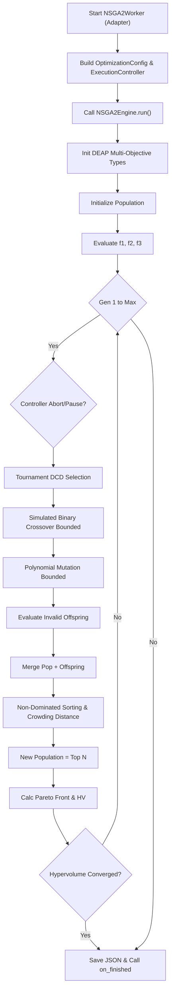

# NSGA-II (Non-dominated Sorting Genetic Algorithm II) Documentation

## Overview
The NSGA-II implementation in DeVana is designed for **multi-objective** optimization of Dynamic Vibration Absorbers (DVAs). Unlike the standard GA which scalarizes multiple goals into a single fitness value via a weighted sum, NSGA-II maintains a Pareto front, allowing the user to examine the tradeoff curve between distinct objectives.

In DeVana, NSGA-II minimizes three distinct objectives:
1.  **FRF Singular Response ($f_1$):** Peak vibration reduction across the masses.
2.  **Sparsity & Complexity ($f_2$):** A penalty for the number of active DVA parameters (using an $L_0$-like threshold and $L_1$ norm).
3.  **Cost ($f_3$):** Direct manufacturing/material cost based on user-defined coefficients.

## Class: `NSGA2Engine` (Headless Engine) & `NSGA2Worker` (Adapter)

### Purpose
The NSGA-II implementation utilizes a headless `NSGA2Engine` in the `devana_lib/` domain layer, completely decoupled from the UI. It uses DEAP to handle the multi-objective selection, Simulated Binary Crossover (SBX), and Polynomial Mutation operators. 

The `NSGA2Worker` (inherits `QThread`) acts as a thin adapter. It translates unstructured UI parameters into an `OptimizationConfig` domain object, instantiates the `NSGA2Engine`, and bridges the engine's Python callbacks into PyQt signals.

### Key Configuration (`OptimizationConfig`)
*   **Physics (`PhysicsConfig`):** Core parameters, `target_values_weights`, frequency ranges, and `dva_params` with fixed flags and cost coefficients.
*   **Sparsity (`SparsityConfig`):** `tau` (activation threshold), `alpha`, `beta`.
*   **Hyperparameters (`NSGA2Hyperparameters`):** `pop_size`, `generations`, `cxpb`, `mutpb`, `eta_c`, `eta_m`, `indpb`, `num_runs`.
*   **Performance Metrics:** `hv_ref_point` for hypervolume calculation.

### Methods (`NSGA2Engine`)

#### 1. `_evaluate(self, individual, config)`
**Purpose:** Calculates the three multi-objective fitness values.
**Parameters:** `individual` (A candidate solution's parameter vector), `config` (The `OptimizationConfig`).
**Logic:**
1.  **$f_1$ (Performance):** Runs standard `frf` analysis based on the provided configuration.
2.  **$f_2$ (Sparsity):** Counts parameters above `sparsity_tau` and multiplies by `sparsity_alpha`, plus an $L_1$ norm weighted by `sparsity_beta`.
3.  **$f_3$ (Cost):** Computes the dot product of the individual and `cost_coeffs`.
**Outputs:** Tuple `(f1, f2, f3)`.

#### 2. `run(self, config, controller, on_progress, on_finished, on_error)`
**Purpose:** Main execution loop for NSGA-II.
**Logic Flow:**
1.  **Initialization:** Uses `@safe_deap_operation` to register `FitnessMulti` and `Individual`.
2.  **Operators:** 
    - `tools.cxSimulatedBinaryBounded` (SBX) is used for crossover.
    - `tools.mutPolynomialBounded` is used for mutation.
    - `tools.selNSGA2` is used for environmental selection.
3.  **Evolution Loop:**
    - Checks `controller.should_abort()` and `controller.wait_if_paused()`.
    - Generates offspring using `tools.selTournamentDCD`.
    - Applies SBX and Polynomial Mutation.
    - Evaluates invalid offspring.
    - Selects the next generation using `tools.selNSGA2`.
4.  **Metrics:** Extracts the first Pareto front (`sortNondominated`), calculates Hypervolume (HV), invokes `on_progress` callback, and checks for convergence.
5.  **Output:** Saves JSON to `nsga2_results/` and invokes `on_finished`.

---

## Architectural Flowchart



### Flowchart Pseudo-code
```text
function run_nsga2():
    register_fitness_multi(weights=(-1, -1, -1))
    pop = generate_initial_population()
    fitnesses = map(evaluate_multi, pop)
    
    for gen in 1..generations:
        offspring = select_tournament_dcd(pop, pop_size)
        apply_sbx_crossover(offspring, cxpb, eta_c)
        apply_polynomial_mutation(offspring, mutpb, eta_m)
        
        evaluate_multi(invalid_offspring)
        
        merged_pop = pop + offspring
        pop = select_nsga2(merged_pop, pop_size)
        
        pareto_front = get_front(pop, 1)
        hv = calculate_hypervolume(pareto_front)
        
        if gen > min_gen and (max(hv_window) - min(hv_window) < epsilon):
            break
            
    return final_pareto_front
```
